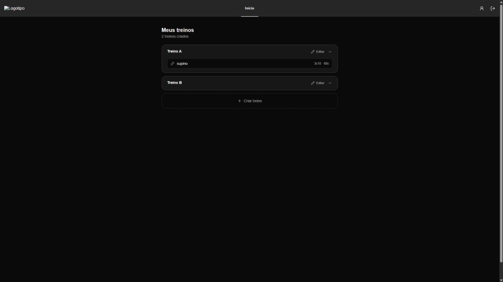

<div align="center">
	
	<h1>GymWorkout</h1>
	<p>Organize seus treinos, exercícios, séries e intervalos em um só lugar.</p>
</div>

<p align="center">
	Aplicação web de organização de treinos com API REST em ASP.NET Core e interface em React.
</p>

## Sobre o projeto

O GymWorkout permite que cada pessoa mantenha seus treinos e exercícios organizados. A aplicação combina uma API com autenticação e uma interface web responsiva para consultar e editar as rotinas.

Este é um projeto de estudo voltado para aprofundar autenticação stateless com JWT e refresh tokens, arquitetura em camadas (Controller / Service / Repository) e integração real entre uma API em .NET e um frontend em React.

Fiz esse projeto porque gosto de academia e estava estudando ASP.NET em um curso. Em vez de só assistir às aulas, quis me desafiar e testar o que tinha aprendido na prática, então criei algo simples e com um tema que me interessa. Também aproveitei para ir além do curso: construí não só a Web API, mas uma aplicação web completa, integrando com um frontend de verdade.

## Capturas de tela

<div align="center">
	
	
</div>

## Funcionalidades

- Cadastro, login, renovação de sessão e logout.
- Token de acesso JWT e refresh token em cookie HttpOnly.
- Criação e edição de treinos pessoais.
- Inclusão de exercícios nos treinos, com séries, repetições e tempo de descanso.
- Catálogo de exercícios com operações administrativas restritas por perfil.
- Perfil do usuário e alteração de senha.
- Interface web com React Router e carregamento de páginas sob demanda.

## Tecnologias

| Área                | Tecnologias                                     |
| ------------------- | ----------------------------------------------- |
| API                 | C#, .NET 10, ASP.NET Core Web API               |
| Persistência        | Entity Framework Core, SQL Server e migrations  |
| Autenticação        | JWT Bearer, refresh tokens e BCrypt.Net         |
| Documentação da API | Swagger / Swashbuckle                           |
| Frontend            | React 19, Vite 8, React Router 7 e Lucide React |

## Estrutura

```text
GymWorkout.API/
├── Configuration/   # Registro de serviços, banco, CORS e autenticação
├── Controllers/     # Endpoints HTTP
├── Data/            # DbContext
├── DTOs/            # Contratos de entrada e saída
├── Entities/        # Entidades persistidas
├── Migrations/      # Histórico do schema do banco
├── Services/        # Regras da aplicação
└── FrontEnd/
		└── src/         # Aplicação React
```

## Requisitos

- .NET SDK 10.
- Node.js compatível com Vite 8 e npm.
- SQL Server local ou remoto.
- VS Code REST Client, opcional, para executar `GymWorkout.API.http`.

## Executar localmente

### 1. Configurar a API e o banco

Na raiz do repositório, configure a conexão do SQL Server. O valor local padrão está em `appsettings.json`; substitua-o pela conexão do seu ambiente e não publique credenciais.

No PowerShell, as variáveis abaixo sobrescrevem a configuração apenas para a sessão atual:

```powershell
$env:ConnectionStrings__DefaultConnection = "Server=localhost\SQLEXPRESS;Database=GymWorkoutDb;Trusted_Connection=True;TrustServerCertificate=True;"
$env:Jwt__SecretKey = "use-uma-chave-local-forte-e-aleatoria"
$env:Jwt__AdminEmail = "admin@exemplo.com"
```

Restaure as dependências e aplique as migrations:

```powershell
dotnet restore
dotnet ef database update
```

Se o comando `dotnet ef` não estiver instalado, instale a ferramenta compatível com a versão do Entity Framework do projeto (o projeto usa .NET 10, mas o pacote do Entity Framework em uso corresponde à versão 8.x do EF, daí a versão abaixo):

```powershell
dotnet tool install --global dotnet-ef --version 8.0.8
```

Inicie a API:

```powershell
dotnet run --launch-profile http
```

A API ficará disponível em `http://localhost:5011`. Em desenvolvimento, o Swagger fica em `http://localhost:5011/swagger`.

> **Catálogo de exercícios:** não há uma tela no frontend para cadastrar exercícios — eles são pensados como um catálogo fixo, já disponível para o usuário escolher ao montar um treino. Por isso, ao rodar o projeto pela primeira vez, o banco estará sem nenhum exercício cadastrado. Use o Swagger (`/swagger`) para criar os exercícios manualmente pelos endpoints de `/Exercises` (acesso de Administrador) antes de testar a criação de treinos pelo frontend.

### 2. Executar o frontend

Em outro terminal:

```powershell
cd FrontEnd
npm ci
npm run dev
```

Abra o endereço informado pelo Vite, normalmente `http://localhost:5173`. Para apontar o frontend para outra instância da API, defina `VITE_API_URL` antes de iniciar o Vite:

```powershell
$env:VITE_API_URL = "http://localhost:5011"
npm run dev
```

O CORS de desenvolvimento já permite a origem `http://localhost:5173`. Para outras origens, configure `Cors:AllowedOrigins` na API.

## API

Os endpoints protegidos recebem `Authorization: Bearer <token>`. O arquivo [GymWorkout.API.http](GymWorkout.API.http) inclui exemplos prontos de login, leitura e criação — é a forma mais rápida de testar a API pelo VS Code REST Client sem precisar rodar o frontend.

| Método                    | Endpoint            | Acesso            | Descrição                              |
| ------------------------- | ------------------- | ----------------- | -------------------------------------- |
| `POST`                    | `/Auth/register`    | Público           | Criar conta                            |
| `POST`                    | `/Auth/login`       | Público           | Iniciar sessão                         |
| `POST`                    | `/Auth/refresh`     | Cookie de refresh | Renovar token de acesso                |
| `POST`                    | `/Auth/logout`      | Cookie de refresh | Encerrar sessão                        |
| `GET`                     | `/Workouts`         | Autenticado       | Listar os próprios treinos             |
| `POST`                    | `/Workouts`         | Autenticado       | Criar treino                           |
| `GET`                     | `/Workouts/{id}`    | Autenticado       | Consultar treino                       |
| `PUT` / `DELETE`          | `/Workouts/{id}`    | Autenticado       | Atualizar ou remover treino            |
| `GET`                     | `/Exercises`        | Autenticado       | Consultar catálogo de exercícios       |
| `POST` / `PUT` / `DELETE` | `/Exercises`        | Administrador     | Gerenciar exercícios                   |
| `GET`                     | `/WorkoutExercises` | Autenticado       | Listar exercícios dos próprios treinos |
| `POST`                    | `/WorkoutExercises` | Autenticado       | Adicionar exercício a um treino        |

O Swagger é habilitado somente quando `ASPNETCORE_ENVIRONMENT=Development`.

## Build e validações

```powershell
dotnet build
```

```powershell
cd FrontEnd
npm run lint
npm run build
```

O build do frontend gera os arquivos em `FrontEnd/dist`.
